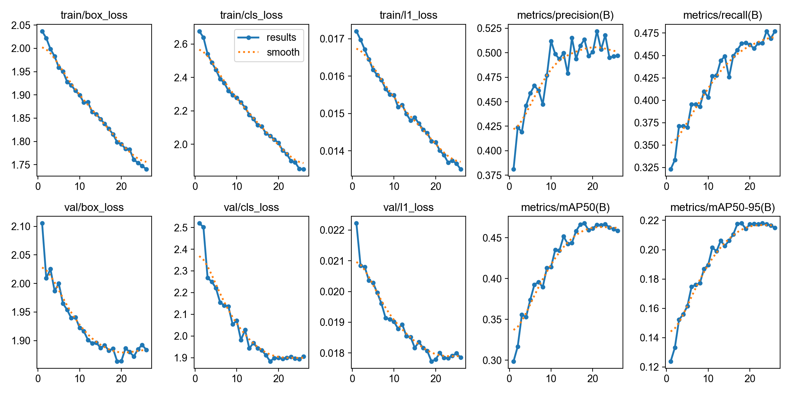
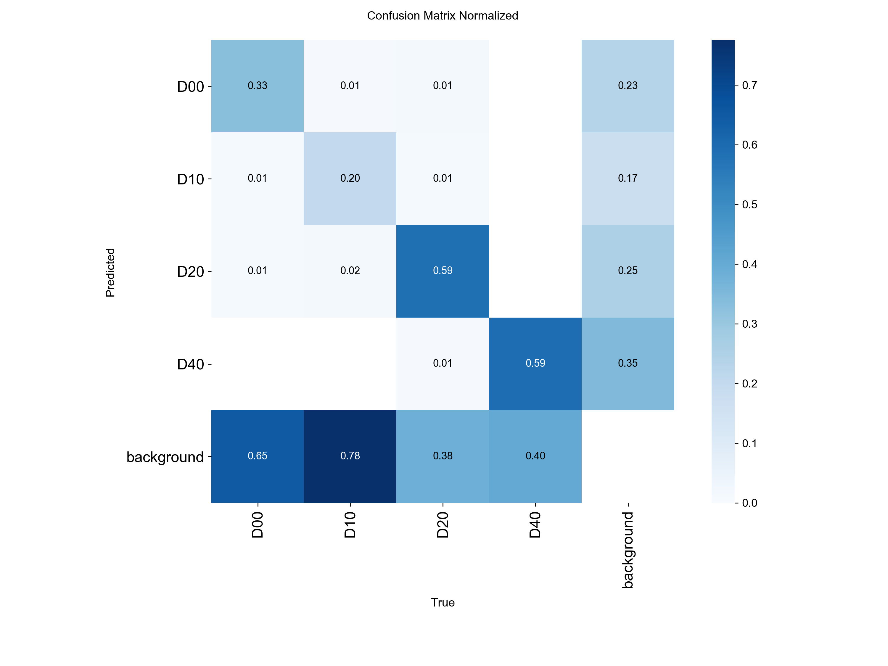
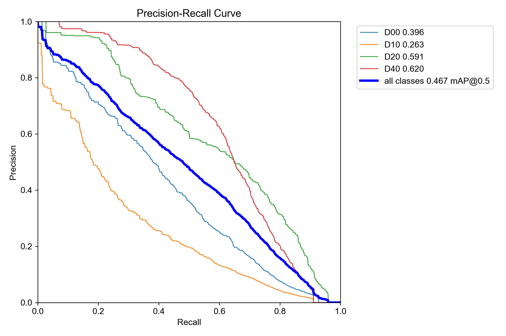
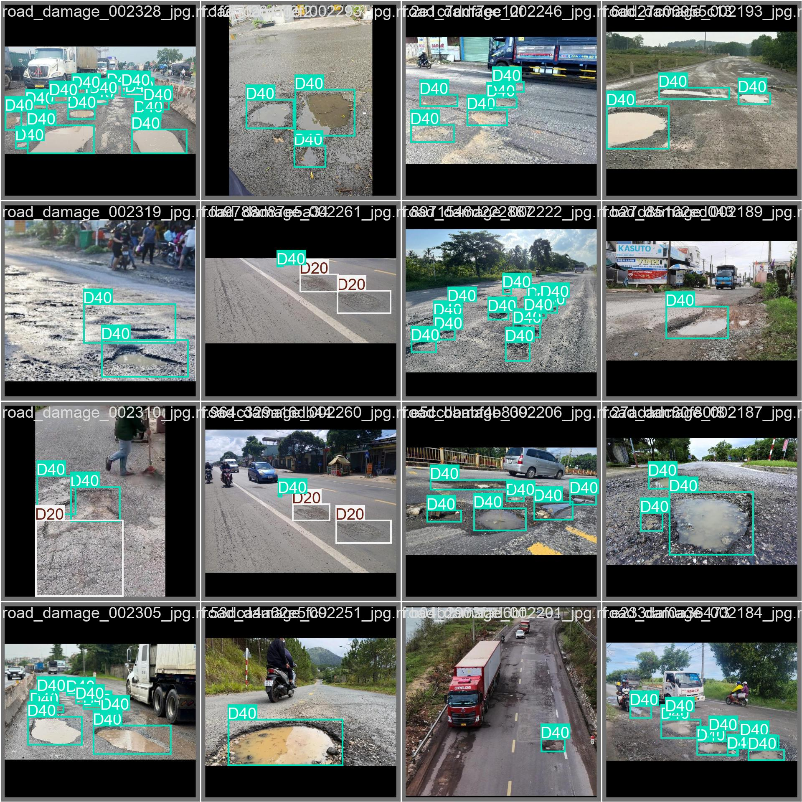
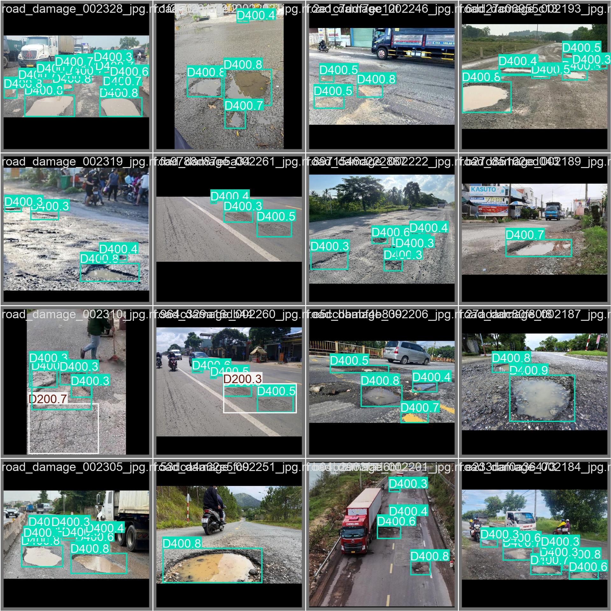

# YOLO26s Road Damage Detection (Vietnam) — `YOLO26s_rdd_vn`

[](https://universe.roboflow.com/kiet-7wdju/road-damage-vn-e1n2w)
[](https://github.com/ultralytics/ultralytics)
[](https://pytorch.org/)
[](https://github.com/kiet7732/YOLO26s_rdd_vn/tree/main/weights)

A lightweight, high-performance object detection model fine-tuned for **automated road damage inspection under Vietnamese traffic and pavement conditions**, developed as part of the Road Damage GIS capstone project.

---

## 📌 Project Overview

This repository contains the fine-tuned checkpoint and experimental evaluations of **`YOLO26s_rdd_vn`**, built upon knowledge-distilled compact YOLO architecture (`YOLO26s_RDD_FRDC_Distilled_v2.pt`). The model detects road surface defects directly from camera feeds or mobile photos with low inference latency and high precision.

* **Base Model**: `YOLO26s_RDD_FRDC_Distilled_v2.pt` (Knowledge Distillation)
* **Target Environment**: Vietnamese urban & rural roads (varying lighting, asphalt wear, weather conditions)
* **Best Checkpoint**: [`weights/best.pt`](weights/best.pt) (19.37 MB)
* **Dataset**: Publicly available on Roboflow:
  👉 **[road-damage-vn Dataset > Overview](https://universe.roboflow.com/kiet-7wdju/road-damage-vn-e1n2w)**

---

## 🏷️ Target Classes

The model identifies 4 standardized road distress categories following the international Road Damage Detection (RDD) guidelines:

| Class Code | Category Name | Vietnamese Description | Typical Severity Impact |
| :--- | :--- | :--- | :--- |
| **`D00`** | Longitudinal Crack | Vết nứt dọc | Medium |
| **`D10`** | Transverse Crack | Vết nứt ngang | Medium |
| **`D20`** | Alligator Crack | Nứt da cá sấu / nứt mai rùa | High (structural degradation) |
| **`D40`** | Pothole | Ổ gà, hố sụt mặt đường | Critical (immediate hazard) |

---

## ⚙️ Training Configuration

The model was fine-tuned using the following hyperparameter recipe (see [`args.yaml`](args.yaml) for full configuration):

| Parameter | Value | Note |
| :--- | :--- | :--- |
| **Input Image Size (`imgsz`)** | `640 x 640` | Standard balance between speed and spatial detail |
| **Batch Size** | `32` | Mixed precision (AMP FP16 enabled) |
| **Optimizer** | `AdamW` | `lr0 = 0.002`, `lrf = 0.01` with Cosine LR scheduler |
| **Early Stopping** | `patience = 8` | Stopped at epoch 26 after peak convergence |
| **Augmentation** | Mosaic (`1.0`), Mixup (`0.1`), RandAugment (`0.4`) | High robustness against occlusions and reflections |

---

## 📊 Experimental Results & Evidence

### 1. Overall Performance Metrics

Convergence reached around **epoch 18–23** with balanced precision and recall across all damage classes:

| Metric | Score | Note |
| :--- | :---: | :--- |
| **mAP@50 (Box)** | **46.76%** | Peak at Epoch 18 (`0.46764`) |
| **mAP@50-95 (Box)** | **21.80%** | Stringent IoU threshold evaluation |
| **Precision** | **52.20%** | Minimizes false positive road surface detections |
| **Recall** | **47.71%** | Robust capture rate across varied road textures |
| **Checkpoint Size** | **19.37 MB** | Ready for mobile/edge and web backend deployment |

---

### 2. Training Convergence & Curves

The training loss and validation metrics steadily improved and stabilized without significant overfitting:


*Figure 1: Training & validation loss curves, precision, recall, and mAP progressions across epochs.*

---

### 3. Classification Accuracy & Trade-offs

| Normalized Confusion Matrix | Precision-Recall (PR) Curve |
| :---: | :---: |
|  |  |
| *Figure 2: Normalized confusion matrix across D00, D10, D20, and D40 classes.* | *Figure 3: Precision-Recall curve across confidence thresholds.* |

---

### 4. Qualitative Validation Samples

Comparison between ground-truth annotations and model predictions on validation batches:

| Ground Truth Labels (`val_batch0_labels.jpg`) | Model Predictions (`val_batch0_pred.jpg`) |
| :---: | :---: |
|  |  |

---

## 🚀 Quickstart & Inference

### 1. Installation

```bash
pip install ultralytics torch torchvision
```

### 2. Python Inference

```python
from ultralytics import YOLO

# Load the fine-tuned best weights
model = YOLO("weights/best.pt")

# Run inference on an image or directory
results = model.predict(
    source="path/to/road_image.jpg",
    conf=0.25,
    iou=0.7,
    save=True,
    device="0"  # or 'cpu'
)

# Print detected damages
for box in results[0].boxes:
    cls_id = int(box.cls[0])
    conf = float(box.conf[0])
    class_name = model.names[cls_id]
    print(f"Detected: {class_name} ({cls_id}) - Confidence: {conf:.2f}")
```

### 3. Exporting to ONNX (Optional for Edge/Web)

```python
model = YOLO("weights/best.pt")
model.export(format="onnx", dynamic=True, simplify=True)
```

---

## 🔗 References & Credits

* **Dataset**: [road-damage-vn Dataset on Roboflow Universe](https://universe.roboflow.com/kiet-7wdju/road-damage-vn-e1n2w)
* **Base Architecture**: Knowledge Distilled Compact YOLO (`YOLO26s_RDD_FRDC_Distilled_v2`)
* **RDD Benchmark Standard**: Deeksha Arya et al., *"RDD2022: A multi-national image dataset for automatic Road Damage Detection"*, arXiv:2209.08538.
